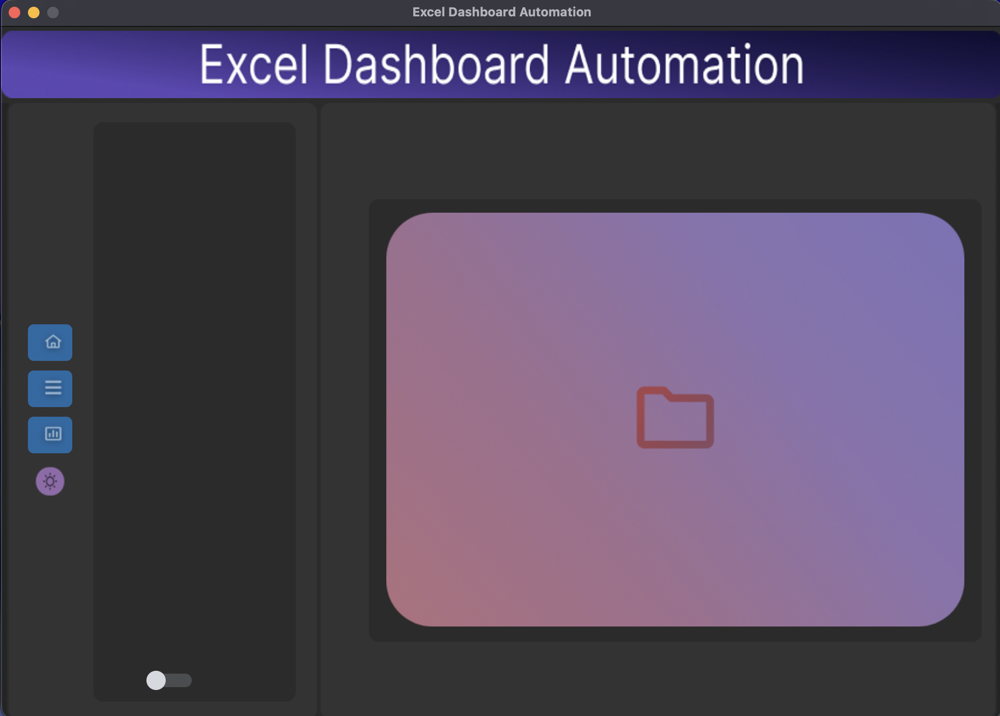
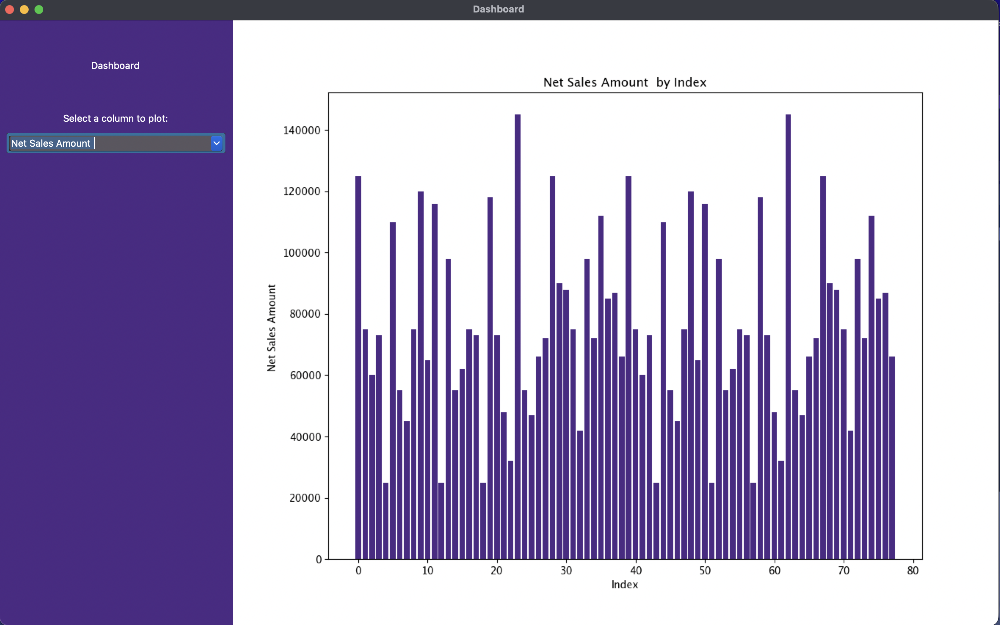

# OCR + Excel Dashboard

A desktop GUI for extracting text and tables from PDFs and images using Tesseract OCR, with a built-in dashboard for visualizing tabular data.



## What it does

- Upload a PDF or image (jpg, jpeg, png, tif, tiff) through the GUI
- The pipeline converts images to PDF, renders pages at 400 DPI, and runs OCR on each page
- Two outputs are produced:
  - **Per-page OCR text** at `data/processed/<doc>/<doc>_page_<N>.txt`: full-page Tesseract output
  - **Extracted table cells** at `data/output/Extracted_Table.csv`: one cell per row, sorted by position, derived from morphological line detection
- A separate dashboard view reads CSV output and plots numeric columns as bar charts, with a column selector

The pipeline uses OpenCV's morphological operations to detect horizontal and vertical lines in tables, find cell contours, and hand each cropped cell to Tesseract for OCR in parallel.

## Requirements

**System dependencies** (install before pip):

- **macOS**: `brew install tesseract poppler`
- **Linux**: `sudo apt install tesseract-ocr poppler-utils`
- **Windows**: install [Tesseract](https://github.com/UB-Mannheim/tesseract/wiki) and [Poppler](https://github.com/oschwartz10612/poppler-windows), and ensure both binaries are on PATH.

**Python**: tested with 3.13 on macOS Apple Silicon. Other 3.11+ versions likely work but are unverified.

The app also needs Tk, the toolkit that Python's built-in `tkinter` module uses to draw windows. Homebrew's Python ships without it, so `import tkinter` fails with `ModuleNotFoundError: No module named '_tkinter'`. Add it with `brew install python-tk@3.13` (for Homebrew's Python 3.13), or with `sudo apt install python3-tk` on Debian or Ubuntu.

## Install


```bash
git clone https://github.com/Atharv-Girish-Chaudhary/Optical-Character-Recognition-and-Excel-Visualisation-Dashboard.git
cd Optical-Character-Recognition-and-Excel-Visualisation-Dashboard
pip install -r requirements.txt
```


## Run


```bash
python main.py
```


> [!WARNING]
> Work on copies of your files. Uploading a PDF moves it out of its folder into `data/raw/`. Uploading an image first saves a PDF of it next to the image, then moves that PDF into `data/raw/`. The PDF takes the image's name, so uploading `scan.png` overwrites any `scan.pdf` in the same folder. The image itself stays where it is.

In the GUI:

1. Click the big folder image in the main pane to show the **From Device** button, then click **From Device** and select a PDF or image. Sample images are bundled at `data/samples/Test_1.png` through `Test_4.png`. The extension check is case-sensitive, so files ending in `.JPG`, `.PNG` or `.PDF` are rejected as unsupported; rename them to lowercase first.
2. Toggle the **progress switch** at the bottom of the left sidebar, in the wide panel beside the icons, to run the OCR pipeline. Status messages appear in the terminal. Each run processes every PDF in `data/raw/`, so files uploaded in earlier runs are processed again. If Tesseract or Poppler is not on PATH, the errors are only printed in the terminal, and the GUI still shows its "File has been converted to Excel file" success message.
3. When the pipeline finishes, the extracted CSV opens automatically. `Extracted_Table.csv` is rewritten for every page that has a table, so it keeps only the last of those tables.
4. Click the **chart icon** in the left sidebar to launch the dashboard. If the pipeline hasn't been run yet, the dashboard falls back to bundled sample invoice and sales data. Once `data/output/Extracted_Table.csv` exists, the dashboard reads it instead and no longer falls back. That file is a single column of cell text, so the dashboard usually shows "No plottable data" for it; move the file aside to see the sample again.



## Project structure


```
.
├── main.py                          # Tkinter GUI entry point
├── requirements.txt                 # Python dependencies
├── modules/
│   ├── file_pdf_conv.py             # File upload + format conversion
│   ├── image_table_conv.py          # PDF → PNG rendering, OCR orchestration
│   ├── table_text_conv2.py          # Cell-level OCR via line detection
│   ├── dashboard.py                 # CSV visualization dashboard
│   ├── directories.py               # Runtime folder creation
│   └── roi.py                       # Region-of-interest utility
└── data/
    ├── gui/                         # GUI icons + screenshot
    └── samples/                     # Bundled test images + sample CSV
```


The `data/raw/`, `data/processed/`, and `data/output/` directories are created at runtime and are gitignored.

## Image preprocessing pipeline

The OpenCV operations below find the table's cells. Steps 1 to 5 work on a copy of the page and only locate the cell boundaries. Step 6 crops each cell from the original page, so Tesseract never sees the processed copy:

1. Grayscale conversion
2. Bitwise inversion
3. Otsu binarization
4. Morphological opening with horizontal and vertical kernels (line detection)
5. Contour extraction on the line mask
6. Per-cell cropping and parallel OCR via `ThreadPoolExecutor`

## Known limitations

- **OCR quality** depends on input image clarity. Small text, low-contrast scans, and stylized fonts produce noisy results.
- **Table structure is partially preserved**. Output is a single-column CSV sorted by cell y-coordinate; full row × column reconstruction is not implemented.
- **No handwriting support**. Tesseract's default English model is used.
- **English only**. Multi-language support is not implemented.
- **CSV output, not Excel**. Despite the project name, results are written as CSV. Direct `.xlsx` export is a planned future improvement.
- **Large images use a lot of memory**. Uploaded images are saved as PDFs at 72 DPI (dots per inch) and then rendered at 400 DPI, about 5.6 times wider and taller. A 12-megapixel photo becomes a page of about 370 million pixels, more than 1 GB for each copy in memory. Pillow, the image library, would normally refuse an image that big, but its size limit is turned off.
- **The dashboard probably fails on Linux**. It calls `root.state('zoomed')`, which Tk supports only on Windows and macOS. This hasn't been tested on Linux.

## Future improvements

- Grid-aware table reconstruction (preserve row × column layout)
- Direct `.xlsx` export with formatting
- Multi-language OCR
- Custom-trained models for handwriting

## License

See [LICENSE](LICENSE).
